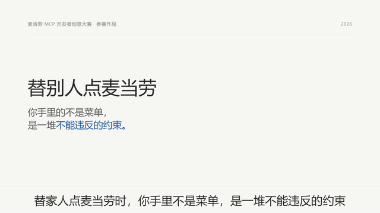
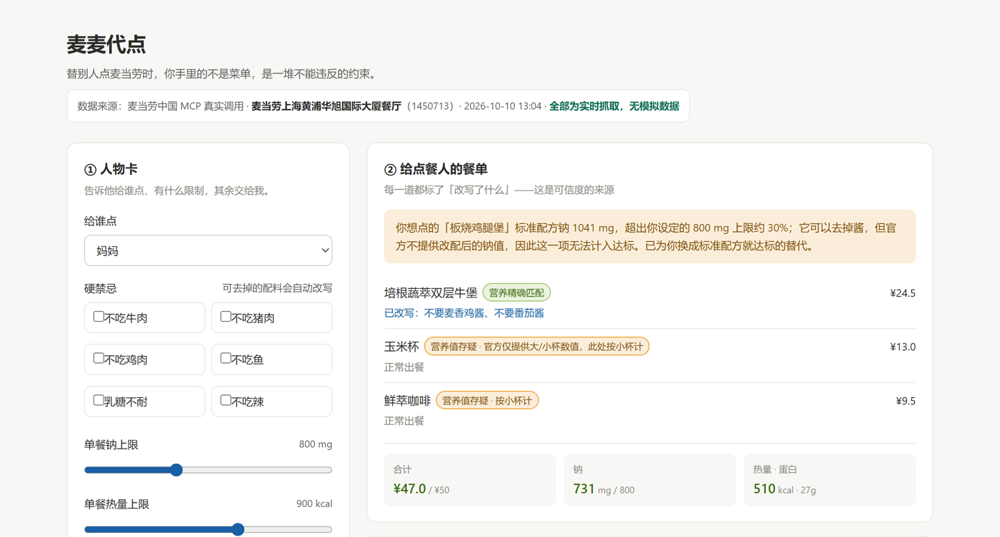
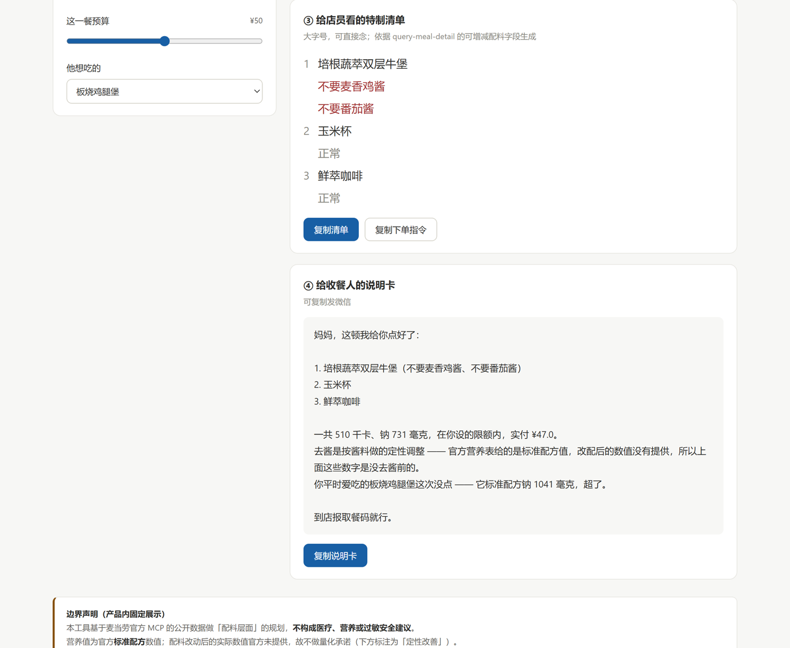

<div align="center">

# 麦麦代点

**替别人点麦当劳时，你手里的不是菜单，是一堆你不能违反的约束。**

把「关系 + 健康 + 忌口 + 预算」翻译成一份**能点、能改、能交代**的单子


</div>

---

[](./assets/promo.mp4)

**▶ 点击封面观看 38 秒完整版** ｜ 另有 [无 BGM 版](./assets/promo-no-bgm.mp4)，便于二次配音

**▼ 14 秒动图预览**（自动播放）



<!-- 【给作者】为什么不直接内嵌 <video>：
     GitHub 网页端会剥离指向仓库内相对路径的 <video> 标签（本机 markdown 预览器同样剥离），
     所以用「封面图 + 链接」——点击后会进入 GitHub 自带的 mp4 播放页，这是最稳的方式。
     若确实要在页内直接播放：把 assets/promo.mp4 拖进任意 Issue 的评论框，
     拿到 https://github.com/user-attachments/assets/xxxx 链接后替换下行的 src 并取消注释。
<video src="https://github.com/user-attachments/assets/xxxx" controls muted loop playsinline width="100%"></video>
-->

---

## 一、这个项目解决什么问题

给爸妈点、给孩子点、给朋友点 —— **你替别人做决策，但你不知道他的约束能不能被满足。**

| 痛点 | 现状 | 为什么现有工具解决不了 |
|---|---|---|
| **不知道忌口能不能被满足** | 全靠猜，或到店问店员 | MCP 里唯一能"改菜"的能力是 `query-meal-detail` 的配料可增减（modification），而它被系统性忽略了 |
| **健康约束算不出来** | 只知道"少油少盐"，不知道差多少 | 营养表有钠/热量，但没人把它翻译成"这顿超了多少" |
| **交代不清** | 到店口头跟店员描述，容易漏 | 缺一份可直接念给店员的结构化清单 |
| **收餐人不理解** | 家里觉得你乱点 | 缺一份可发微信的说明 |

### 一个被核实过的市场空缺

我们对本次大赛 **215 条报名 Issue（去重后 184 个真实项目）** 做了全量分类与逐字检索：

- **"给自己点"占 182 个，"替别人点"只有 2 个**
- 真正用到 `query-meal-detail` 配料可增减能力的**只有 6 个项目，且全部是"给自己点"**

而 `query-meal-detail` 恰好是麦当劳 MCP 唯一能"改菜"的能力。**别人的忌口不是营养问题，是配料问题** —— 营养表只能告诉你"这菜有多少钠"，只有 modification 能告诉你"这菜能不能去掉酱"。

---

## 二、目标用户

**主用户：替家人点餐的中青年子女 / 家长。** 场景是到店自取后带回家。

他们共同的特征是：**决策成本极高（信息要收集、约束要翻译、结果要对别人负责），而现有工具为零。**

> 父母多数不会用手机点餐，给他们叫外卖也不实用 —— 所以交付物是**取餐码 + 特制清单**，由子女去取。

**次用户：企业行政 / HR / 组局人。** 同一套约束翻译能力可用于多人场景（谁不能吃什么）。

**明确不服务**：高频省钱党（自己最会算，且已有 45 个项目服务）、纯情绪社交用户（该群体 20 个项目平均 Star 仅 0.95）。

---

## 三、输出的三件套

### ① 给点餐人的餐单

每道菜标注**改写了什么**，并给出营养合计与达标状态。**"改写了什么"是可信度的来源，不能省。**

### ② 给店员看的特制清单

大字号、可直接念：

```
1  培根蔬萃双层牛堡
   不要麦香鸡酱
   不要番茄酱
2  玉米杯
   正常
3  鲜萃咖啡
   正常
```

> 没有改写的餐品也要列出并标「正常」—— 店员需要完整的对照。

### ③ 给收餐人的说明卡

可复制发微信，含点了什么、营养结论、为什么这么改、取餐方式。

---

## 四、演示

**输入人物卡 + 输出餐单**（默认场景：给高血压的妈妈点，钠上限 800mg，她爱吃板烧）



**特制清单 + 说明卡 + 边界声明**



---

## 五、安装与运行

本项目提供两种形态，**共用同一套约束翻译逻辑**。

### 形态 A：网页原型（零依赖，双击即用）

```bash
git clone https://github.com/<your-name>/mcd-daidian.git
cd mcd-daidian/src
# 直接用浏览器打开 index.html
```

或起一个静态服务：

```bash
python -m http.server 8000
# 打开 http://127.0.0.1:8000/index.html
```

> 原型内置一份**真实 MCP 调用快照**（门店 `1450713`「上海黄浦华旭国际大厦餐厅」，2026-10-10 采集），所以**不填任何 Token 就能跑通完整流程**。

### 形态 B：WorkBuddy Skill（在对话里用）

1. 在 WorkBuddy 中配置麦当劳 MCP 连接器（见 [MCP_INTEGRATION.md](./MCP_INTEGRATION.md#一连接器配置)）
2. 将 [`skill/SKILL.md`](./skill/SKILL.md) 安装为本地 Skill
3. 直接说人话：

```
帮我妈点个麦当劳，她高血压，预算 40
给孩子点一份，别太甜
帮同事带一份，他不吃牛肉
```

---

## 六、使用示例

**输入**（一次收齐人物卡）

| 项 | 值 |
|---|---|
| 给谁点 | 妈妈 |
| 硬禁忌 | 无 |
| 健康约束 | 高血压 → 单餐钠上限 800 mg |
| 预算 | ¥50 |
| 软偏好 | 爱吃板烧鸡腿堡 |

**输出**

| 项 | 结果 |
|---|---|
| ❌ 板烧鸡腿堡 | 标准配方钠 **1041 mg**，超出上限 **30%** → **被否，并说明原因** |
| ✅ 培根蔬萃双层牛堡（不要麦香鸡酱、不要番茄酱） | 已改写 |
| ✅ 玉米杯 | 正常 |
| ✅ 鲜萃咖啡 | 正常 |
| **合计** | ¥47.0 / 钠 731 mg（限额 800）/ 510 kcal · 蛋白 27 g |

**关键差异**：它**否掉了用户最想吃的那一项**，并解释为什么 —— 而不是给出一个"看起来更健康"的列表。

---

## 七、MCP 集成

调用 5 个只读工具，完整链路、参数、真实返回样张与业务价值见 **[MCP_INTEGRATION.md](./MCP_INTEGRATION.md)**。

```
query-nearby-stores  →  query-meals  →  query-meal-detail（核心）
      →  list-nutrition-foods  →  calculate-price
```

**技术地基已验证**：`query-meal-detail(code=1406, storeCode=1450713)` 真实返回

```json
"modification": { "items": [{ "maxValues": 2, "minValues": 0, "values": [
  { "code": "102201", "price": 0, "name": "烤味酱",   "selectedKey": "0-1", "unselectedKey": "0-0" },
  { "code": "120512", "price": 0, "name": "切块生菜", "selectedKey": "0-1", "unselectedKey": "0-0" }
]}]}
```

→ **「去掉烤味酱」是一个真实可执行、且不加价（`price: 0`）的操作。**

---

## 八、数据边界与诚实声明

**这一节是产品可信度的来源，不是免责套话。**

| 官方数据缺口 | 实测依据 | 本项目的处理 |
|---|---|---|
| 营养表滞后于菜单 | 有参赛项目实测某门店 128 个在售餐品仅 28 个能匹配营养表（**21.9%**） | 每个餐品标注**营养匹配状态**：精确 / 存疑 / 无数据；**存疑项不参与阈值硬判定** |
| 营养值为标准配方值 | 板烧鸡腿堡标准配方钠 1041 mg；去酱后官方不提供新值 | 改写项标注「已改写」，但**明确声明不量化改写后的营养变化** |
| 营养接口无过敏原字段 | `list-nutrition-foods` 只返回能量/蛋白/脂肪/碳水/钠/钙六项 | 结论限定为「**配料层面能否规避**」，**不承诺医学安全**；高危过敏提示咨询门店 |

> 本工具基于麦当劳官方 MCP 的公开数据做配料层面的规划，**不构成医疗、营养或过敏安全建议**。
> 营养值为官方标准配方数值，配料改动后的实际数值官方未提供，故不做量化承诺。
> 如有严重过敏或慢性病，请以门店现场确认为准。

---

## 九、目录结构

```
.
├── README.md                       # 本文件
├── CONTEST_DECLARATION.md          # 参赛声明（官方原版，未作任何修改）
├── MCP_INTEGRATION.md              # MCP 集成说明（工具、调用流程、业务价值）
├── workbuddy.md                    # WorkBuddy 开发对话上下文（用于专项奖励核验）
├── src/
│   └── index.html                  # 可运行原型（单文件，零依赖，内置真实调用快照）
├── skill/
│   └── SKILL.md                    # WorkBuddy Skill 定义
├── docs/
│   └── PRODUCT.md                  # 产品文档（市场分析、目标人群、功能规格、风险）
└── assets/
    ├── promo.mp4                   # 38s 产品片（带 BGM）
    ├── promo-no-bgm.mp4            # 38s 产品片（纯 SFX 版）
    ├── video-cover.png             # 视频封面（点击可播放）
    ├── preview.gif                 # 14s 动图预览（自动播放）
    ├── screenshot-1-input-output.png
    └── screenshot-2-deliverables.png
```

---

## 十、三条硬规矩

1. **Token 绝不进前端** —— 一切经服务端代理，读环境变量；仓库不含任何真实 Token / 账号 / 订单号
2. **只调只读工具** —— 不用 `create-order` / `auto-bind-coupons` / `draw-lottery` 等写操作
3. **下单交给用户确认** —— 网页端只输出"可复制的下单指令"，由用户在 WorkBuddy 里确认执行

---

## 十一、参赛信息

| 项 | 内容 |
|---|---|
| 赛题 | 麦当劳程序员创意开发大赛（[M-China/mcd-developer-innovation-challenge](https://github.com/M-China/mcd-developer-innovation-challenge)） |
| MCP Server | `https://mcp.mcd.cn`（Streamable HTTP） |
| 数据采集 | 门店 `1450713` 麦当劳上海黄浦华旭国际大厦餐厅，2026-10-10 |

本项目为参赛作品，由参赛者独立开发，**非麦当劳官方产品**。
